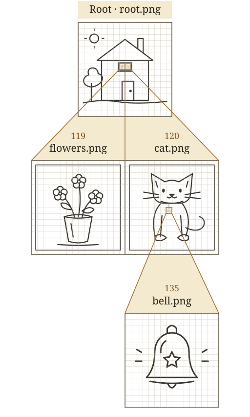

# The .cliopaint file format

Version 10, October 2026

This describes the `.cliopaint` format, a format for storing raster images with arbitrarily high levels of
detail in certain areas.

A `.cliopaint` file is a ZIP file. It contains one or more PNG or JPEG tile images plus two required files,
`preview.jpg` and `manifest.json`. All entries use ZIP’s "stored" method: the ZIP container adds no
compression to the images inside it. The images have 8 bits per color component and no transparency.

The images are tiles in a tree. Each tile gives an overview of its area; its children supply finer detail in
selected parts. A reader can display the overview immediately and load deeper tiles as the viewer zooms in.

## Example file



The corresponding `manifest.json` is:

```json
{
  "version": 10,
  "root": 0,
  "tiles": [
    {
      "payload": "root.png",
      "nativeSide": 512,
      "children": { "119": 1, "120": 2 }
    },
    {
      "payload": "flowers.png",
      "nativeSide": 256,
      "children": {}
    },
    {
      "payload": "cat.png",
      "nativeSide": 512,
      "children": { "135": 3 }
    },
    {
      "payload": "bell.png",
      "nativeSide": 128,
      "children": {}
    }
  ]
}
```

## The archive

Every tile image referenced by the manifest must be present in the zip, along with `manifest.json` and
`preview.jpg`. The manifest and tiles describe the painting; the preview provides a thumbnail.
Entries may appear in any order.

Entry names are unique UTF-8 filenames, with no directories or path separators. Tile names end in `.png`,
`.jpg`, or `.jpeg`; the extension identifies the encoding. Names need not contain tile coordinates or follow
any numbering scheme. Use the exact names in the manifest, and avoid creating names that differ only in case
or Unicode normalization.

A `.cliopaint` archive may contain additional files: readers can ignore files not described here.

## Tiles and their children

Every tile is a square PNG or JPEG image with exactly one of four sizes: **512 × 512, 256 × 256, 128 × 128, or
64 × 64 pixels**. The manifest records each tile’s dimensions in `nativeSide`. This value must equal both the
width and the height of its PNG or JPEG.

For positioning children, every tile uses its own **512 × 512 coordinate grid**, regardless of its image size.
We call the units in this grid _logical pixels_:

| Stored image | Each stored pixel covers |
| ------------ | ------------------------ |
| 512 × 512    | 1 × 1 logical pixels     |
| 256 × 256    | 2 × 2 logical pixels     |
| 128 × 128    | 4 × 4 logical pixels     |
| 64 × 64      | 8 × 8 logical pixels     |

A  tile's image always fills the tile's entire area. To obtain a 512 × 512 raster from a low-res tile file,
stretch it nearest-neighbor.

Tile images are opaque RGB color images with 8-bit components. PNGs use truecolor RGB without an alpha
channel; JPEGs decode to RGB. PNG is lossless, JPEG is lossy, and a painting may mix them. Writers should use
sRGB. Readers should honor embedded color profiles when converting pixels to their working color space. An
image's top-left pixel is at logical coordinate (0, 0), with x increasing to the right and y increasing
downward.

A tile is divided into a 16 × 16 grid of **32 × 32 logical-pixel patches**. Each patch may have one child.
That child’s entire 512 × 512 logical image occupies the patch, so its logical pixels are sixteen times finer
in each direction. It can have children of its own, using the same rule.

The grid is numbered across each row, starting at the top left. A child at column `cx` and row `cy`, both from
0 to 15, has key `16 × cy + cx`. For example, key `119` is column 7, row 7: the parent patch from (224, 224)
up to, but excluding, (256, 256). This placement is independent of either image's stored size. A 32 × 32 patch
is not a permitted stored raster size (since that's just the resolution that the parent tile already has;
there'd be no point).

Every tile includes an image of its whole area, even when it has children. Where a child exists, the parent’s
patch serves as its summary when viewed from a distance. Writers are encouraged to make that summary a
reasonable approximation of the child, for example by averaging its pixels, but agreement is not required. The
format sets no error tolerance or mandatory reduction filter.

The canvas outside the root tile is white.

When a viewer renders a child, the child replaces the entire parent patch, including any white pixels. Where
no child exists, the parent’s pixels remain the image. The choice of when a viewer should display a child
rather than the parent belongs to the viewer.

These ratios are deliberate. We experimented with different tile sizes, nesting structures, and refinements. A
512-pixel tile with children occupying 32-pixel patches performed best across a wide range of editing
and rendering scenarios, balancing filesize and speed of rendering.
These are now fixed dimensions in this format, not tuning parameters.

## manifest.json

The manifest is a UTF-8 JSON object. Its `version`, `root`, and `tiles` fields are required.
JSON object members can appear in any order.
The manifest and its tile objects may contain additional fields not described here. Readers should
ignore fields they do not recognize.

- `version` is the integer format version and must be `10`.
- `root` is the zero-based index of the root in `tiles`. It need not be the first entry.
- `tiles` is a nonempty array of tile objects. Each has a `payload` filename, a `nativeSide` of 64, 128, 256,
  or 512 matching the encoded image’s width and height, and a `children` object. A leaf has `"children": {}`.

Read the version before interpreting the rest of the manifest. Unknown JSON fields in a supported version must
be ignored, but an unknown version should not be assumed compatible.

Each member of `children` maps a grid position to a tile index. Its key is a string containing an integer from
0 to 255 in decimal, with no sign or leading zeros. Its value is a zero-based integer index into `tiles`, not
an image filename.

Starting at `root`, these references must form a tree: no cycles and no tile index reached more than once.
Every referenced index and image must exist. Separate tile objects may refer to the same image file. Writers
should omit unreachable tile objects; readers need only visit the tree reachable from the root. Even a blank
painting must contain a root tile; its image is white.

## preview.jpg

`preview.jpg` is required. It is an ordinary opaque JPEG for thumbnails and quick inspection. A common size is
1024 × 1024 pixels, but any dimensions are allowed.

The preview commonly depicts part of the artwork, but there are no constraints: the
preview can be anything.

## ZIP details

The container uses a small subset of the
[ZIP specification](https://pkware.cachefly.net/webdocs/APPNOTE/APPNOTE-6.3.9.TXT). These restrictions let
readers locate image bytes directly from the directory without using a zip library.

- All entries use method 0, "stored". Compressed and uncompressed lengths are equal. CRC-32 and lengths are
  written in both the local header and the central directory; there are no data descriptors.
- Local headers have no extra fields. Entry contents therefore begin 30 bytes plus the UTF-8 filename length
  after the local-header offset. The local and central filenames are identical.
- The general-purpose flags are either zero or `0x0800` (UTF-8 names). Names are UTF-8 in either case, are
  nonempty, and contain no NUL. There is no encryption, no entry or archive comment, no directory or
  symbolic-link entry, and no split archive.
- Each entry's length is less than `0xffffffff` bytes. Individual lengths never use ZIP64. The archive as a
  whole can be larger.
- Central-directory extra fields are absent unless an entry’s local-header offset is at least `0xffffffff`. In
  that case, the ordinary offset field is `0xffffffff` and the sole extra field is ZIP64: tag `0x0001`, data
  length 8, followed by the 64-bit offset. Like other ZIP integers, these are little-endian.
- ZIP64 end records are used when the entry count reaches `0xffff`, or the directory size or offset reaches
  `0xffffffff`. The directory is followed by the 56-byte ZIP64 end record, its 20-byte locator, and the
  ordinary 22-byte end record. Without ZIP64, only the ordinary end record is needed.

Local records start at byte zero and are contiguous up to the central directory, with no gaps. Every local
record is listed in the directory. The directory and end records are contiguous, and the ordinary end record
ends the file; there is no trailing data.

(However, during editing, a file may temporarily contain gaps between live entries. These gaps can contain obsolete
local headers and image data. A streaming ZIP reader cannot reliably read this state: use the current central
directory at the end to identify the live entries and their locations.
An editor must restore the streaming-readable layout before finishing an editing session normally. A crash or
forced termination may leave the file in its temporary state. Its manifest and tile structure are unchanged;
only the ZIP layout differs.)

## Application-specific extra fields and files

An application may store additional fields in manifest.json, and additional files in the zip.
Clio Infinite Paint stores its "camera" field in manifest.json. It is not part of the file format spec.

```
  "camera": {
    "x": "135",
    "y": "120",
    "e": -8,
    "fx": 0.5,
    "fy": 0.5,
    "scale": 512
  }
```

The `camera` object denotes a camera viewpoint,
by a combination of (1) the screen-width of the root tile, and (2) the centerpoint of the view
within that root tile. The root tile is deemed to cover the unit square: (0,0) at the top left and (1,1)
at the bottom right.

- Root tile width = _scale_ × 2<sup>−*e*</sup> = 131,072 points, so `bell.png` is exactly 512 screen points
  wide.
- Centerpoint = ((_x_ + _f_<sub>x</sub>) × 2<sup>_e_</sup>, (_y_ + _f_<sub>y</sub>) × 2<sup>_e_</sup>) ≈
  (0.529, 0.471), roughly the center of the bell.

This camera field is liable to change in future, maybe in favor of a bookmark system.
